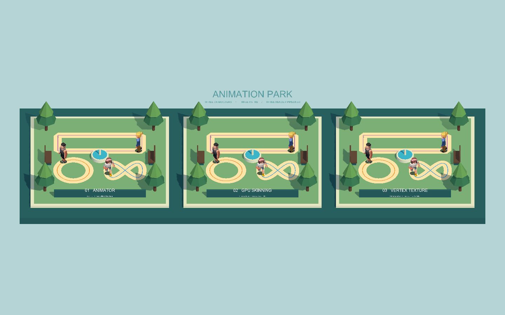

# GPU Skinning Lab

[English](#english) · [中文](#中文)

## English

Bake skeletal animation into textures and play it on the GPU with instancing.

**Author:** Siyuan Zheng · Unity 2022.3.62f3 LTS · URP 14.0.12

### Techniques

- **Bone Animation Texture (BAT):** stores bone matrices per frame; the vertex shader skins each vertex.
- **Vertex Animation Texture (VAT):** stores vertex positions and normals per frame; the vertex shader reads them directly.
- **Native Animator:** Unity's standard animation, used as the reference.

### Getting Started

1. Open the project with Unity 2022.3.62f3.
2. Open `Assets/GpuSkinningDemo/Generated/CharacterPark/CharacterPark.unity` and press Play.
3. To bake your own character, use **Tools > GPU Skinning > Baking Window**.

---

## 中文

把骨骼动画烘焙成贴图，在 GPU 上用实例化批量播放。

**作者：** 郑斯远 · Unity 2022.3.62f3 LTS · URP 14.0.12

### 技术

- **骨骼动画贴图（BAT）：** 按帧保存骨骼矩阵，由顶点着色器完成蒙皮。
- **顶点动画贴图（VAT）：** 按帧保存顶点位置和法线，由顶点着色器直接读取。
- **原生 Animator：** Unity 标准动画系统，作为参照。

### 快速开始

1. 用 Unity 2022.3.62f3 打开项目。
2. 打开 `Assets/GpuSkinningDemo/Generated/CharacterPark/CharacterPark.unity`，点击 Play。
3. 烘焙自己的角色：**Tools > GPU Skinning > Baking Window**。
